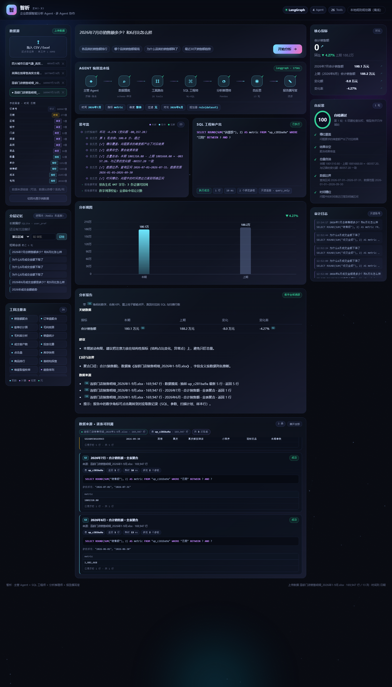

# 智析 ZHI-XI · 自然语言数据分析 Agent

> 一句中文问题 → 可审计的取数 → 带溯源的归因结论。
> 业务方不会写 SQL，走数据团队排期要等几天；这个项目把这段等待压缩成一次对话，并且**每个数字都能点回它来自哪条 SQL**。



## 它解决什么问题

分析工具最难的不是"算出结论"，是**让人敢用这个结论**。所以这一屏里三样东西必须同时在场：

- **过程**：7 个节点的执行链路逐个点亮，每一步的耗时是真实墙钟（`performance.now()`），不是假进度条；
- **依据**：每次取数登记为一条证据，带命中表、返回行数、`EXPLAIN` 扫描计划、绑定参数值、原始样本行；
- **体检**：6 项硬检查加权打分（槽位覆盖、结果非空、总量自洽、贡献可加性、数据边界、时间槽位），不通过退回补查，最多 3 轮。

## 三个它跟"套壳 BI"不一样的地方

**1. 报告里的数字、右侧 KPI、图上的柱子，点一下都跳到底层 SQL。**
不是装饰性角标：`⟦S2⟧` 是证据编号，点击滚动到对应证据卡并高亮；KPI 主数字、每一条关键指标、ECharts 柱子和折线都挂着 `data-ev` 指向具体的取数记录。撰写官拿不到原始数据，只能消费结构化结论对象 —— 溯源是架构上断开的，不是事后补的。

**2. 换一张表，问法一个字不用改。**
CSV / Excel 拖进来，秒级完成解析 → 建表 → 字段画像 → 元数据落盘。字段角色（时间 / 指标 / 维度 / 标识）在入库时推断一次并持久化，规划器只认标签不认列名；SQL 里的列名全部从画像取，**问句里的字一个都不进 SQL**。

实测样本（`samples/线上广告投放日报_2026年1-6月.csv`，4,525 行 / 11 列）：

| 原文件的坑 | 系统的反应 |
| --- | --- |
| 「备注」整列全空 | 入库 10 列，整列丢弃 |
| 列名前后带空格（导出系统脏格式） | 入库前统一清洗 |
| 「投放流水号」4,525 个唯一值 = 行数 | 判成**标识列**，不会被拿去 GROUP BY |
| 5 个数值列、3 个低基数列 | 自动分成 5 个指标 + 3 个维度 |

**3. 归因不瞎猜维度。**
"为什么华南区 7 月销售额降了"，早期版本随便挑一个维度拆，答成"深圳降了 65%"——深圳是地点，不是原因。现在先算每个候选维度的**波动集中度**（最大成员变化额 ÷ 全部成员变化额绝对值之和），渠道 0.886 > 城市 0.65，所以它自己选了渠道：外卖少了 13.2 万，占全部波动的 88.6%。

## 快速开始

需要 Python 3.10+。

```bash
python -m venv .venv
.venv\Scripts\activate            # macOS/Linux: source .venv/bin/activate
pip install -r requirements.txt

python gen_data.py                # 生成内置演示库 data/zhixi.db（星型模型，约 31 万行）
python _run_server.py             # 起服务：http://127.0.0.1:8010
```

Windows 上也可以直接双击 `启动智析.bat`：它会探测 8010 是否已在跑，没跑就后台拉起（pythonw 无窗口），起来后自动开浏览器。

不配任何 API Key 也能完整跑通 —— 规划层默认是**本地规则引擎**，离线、确定、可单测。要接模型见下文。

## 架构

```
用户问题（中文）
      │
┌─────▼──────┐   执行计划 Plan(JSON)   ┌────────────┐
│  主管 Agent │ ─────────────────────▶ │  工具路由   │ 26 个工具，按意图给候选集
│ (规划器)    │                        └─────┬──────┘
└────────────┘                              ▼
        ▲                            ┌────────────┐  参数化 SQL   ┌──────────────┐
        │ 检查点 / 条件边             │ SQL 工程师  │ ───────────▶ │ SQLite(只读) │
        │                            └─────┬──────┘               └──────────────┘
        │                                  ▼ 结果集
        │                            ┌────────────┐
        │                            │ 分析推理师  │ 总量/环比/贡献拆解/3σ 异常
        │                            └─────┬──────┘
        │                                  ▼ 结构化 Conclusion
        │   不通过(≤3轮)             ┌────────────┐
        └──────────────────────────  │  自反思     │ 6 项硬检查加权
                                     └─────┬──────┘
                                           ▼
                                     ┌────────────┐
                                     │ 报告撰写官  │ 只消费结构化结论 + 数字溯源闸门
                                     └────────────┘
```

- **编排**：LangGraph `StateGraph`（条件边 + 循环重试 + 检查点）；未安装时自动退化为行为一致的原生状态机。
- **工具层**：26 个工具，全部 Pydantic 强校验，非法参数在执行前拦截。
- **SQL 安全**：语句白名单只放行 SELECT + `?` 全参数化 + `mode=ro` 只读连接 + `PRAGMA query_only` + 8 秒超时 + 5000 行上限。"生成即校验 / 执行即兜底 / 失败即回退"三层都落在代码上，不是文档里。
- **流式**：SSE 逐节点推送，前端排队播放（日志 165ms/条、报告 75ms/块），不做队列的话 30 条日志会一瞬间刷完等于没显示。
- **审计**：每次查询的 SQL / 用户 / 行数 / 耗时全部落 `audit_log`。

## 两条分析路径（刻意的，不是没统一）

| | 内置业务模型 | 上传数据 / 通用引擎 |
| --- | --- | --- |
| 指标来源 | `METRICS` 白名单，SQL 表达式写在代码里 | 运行时从字段画像里选列 |
| 能力 | 跨表指标：毛利、ROI、库存周转 | 单表聚合：总量、排行、趋势、归因、环比 |
| 数据模型 | 星型模型（3 张事实表 + 维表） | 任意一张扁平表 |
| 取舍 | 准、快，但只认自己的模型 | 什么表都能问，但不做跨表 join |

优先级简单：激活了上传数据集就走通用引擎，否则走内置模型。有领域模型就用专用工具，没有就用通用引擎。

## 目录

```
app/
├─ graph.py       LangGraph 状态图（7 节点：主管→摸底→工具→SQL→分析→反思→撰写）
├─ planner.py     LLM 规划器（OpenAI 兼容端点，失败自动降级）
├─ nlu.py         本地规则规划器（离线兜底）
├─ datasets.py    上传数据集：解析→建表→字段画像→元数据
├─ generic.py     上传数据的 NL2SQL 与归因（列名只从画像取，问句不进 SQL）
├─ sql_engine.py  三层安全防护 + EXPLAIN/样本溯源
├─ tools.py       26 个工具 + 路由
├─ analyst.py     归因拆解 / 量价 / 3σ 异常
├─ reflect.py     自反思 6 项硬检查
├─ reporter.py    报告生成 + 数字溯源闸门 + ⟦Sx⟧ 角标
├─ memory.py      分层记忆 + 审计
└─ main.py        FastAPI（SSE 流式 + /api/upload）
web/              指挥中心前端（原生 JS + ECharts 本地打包，零构建）
samples/          可直接拖进去测的样例表
gen_data.py       生成内置演示库
make_sample_ads.py / make_sample_sales.py   生成样例表
ingest_*.py       真实公开数据集入库脚本
e2e_*.py          端到端回归脚本
docs/演示脚本.html  九幕演示走查 + 工程追问应答（面试用）
```

## 接真实模型（可选）

```bash
ZHIXI_LLM_KEY=sk-xxx
ZHIXI_LLM_BASE=https://dashscope.aliyuncs.com/compatible-mode/v1
ZHIXI_LLM_MODEL=qwen-plus
```

模型只负责"出 JSON 计划"，取数、计算、报告、反思全在本地代码里——模型抽风不会把链路搞挂。同一句问法两次生成不同 SQL 的问题，在演示场景里不可接受，所以默认走规则。

## 边界（明确没做的）

- **规划层是规则引擎**：覆盖了时间解析、指标/维度匹配、过滤、归因、粒度，但特别口语的问法会退化。LLM 通道留了入口，默认关着。
- **只有单表聚合**：不支持多表 join、不支持自定义计算字段。跨表要先进内置模型。
- **权限没做**：本地单用户，谁都能激活任意数据集。行级过滤、列级脱敏只在设计上。
- **没有调度**：数据靠人上传，没有增量水位线，现在是全量替换。
- **SQLite 单机**：千万行以下够用（当前最大表 17 万行，聚合百毫秒级），再往上要换列存。
- **没有自动化回归**：手工核对了 8 个典型问题，黄金集还没建。

## 数据来源

- **内置演示库**：`gen_data.py` 合成，明确标注为合成数据，不冒充真实来源。
- **`samples/` 样例表**：`make_sample_ads.py` 生成，用于验证"换张表也能问"。
- 另有两个真实公开数据集入库脚本：UCI Online Retail（英国电商真实交易，2011-10 ~ 2011-12）、Open-Meteo 四城市日度气象（ECMWF ERA5）。运行 `ingest_retail.py` / `ingest_real.py` 后，报告里的来源会渲染成可点击的真链接。

## License

MIT
